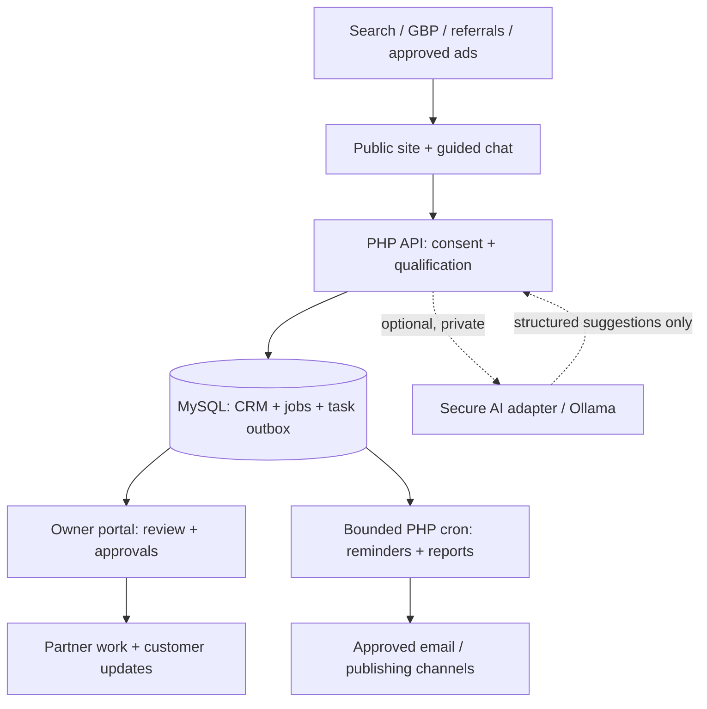

# V9 architecture — deployable on existing Hostinger

**Status: DESIGN, NOT EXECUTABLE V9 CODE.** The implementation remains V8 until each migration/endpoint has been built and tested.

## Decision ADR-001: modular monolith

**Choose:** one PHP 8.1+ app with MySQL/MariaDB, short scheduled cron batches and an optional AI provider. Reuse V8 `public_html/`, `secure-setup/` and role-based portal rather than adding WordPress, Node, RabbitMQ, Redis, containers or 2+ VMs. This is the least complex deployable path on the user's existing Hostinger plan. Scale only when observed load/requirements justify it.



The AI adapter is *not* a separate business system: no independent database or right to commit workflows; the PHP business layer always validates and authorizes any suggestion.

## Boundaries and ownership

| Layer | Owns | Must not do |
|---|---|---|
| `public_html/` website | Public pages, semantic CTAs, consent form, accessibility | Store private keys, API credentials, secrets or real customer data in JS |
| PHP API | Validation, authorization, dedupe, state machines, consent checks | Trust browser-supplied role, price, approval, IP headers or arbitrary tool commands |
| MySQL | Durable leads, tasks, approvals, event/outbox records, reporting | Serve as public customer query endpoint |
| Owner portal | Review, scope, quotes, partner selection, campaigns, spend approvals | Silently mark a model recommendation as owner-authorized |
| Partner portal | Assigned, scoped work and progress notes | Read unassigned leads, finances or contact fields |
| Cron worker | Bounded retryable due tasks, scheduling, reconciliation alerts | Send arbitrary campaigns, authorize work, bypass unsubscribe |
| AI adapter | Categorization, extraction, response/content drafts | See all customers, write SQL, place ads, send messages, quote/bind, dispatch partners |
| External APIs | Consented transport/analytics/approved marketing delivery | Be assumed accessible before OAuth/app review/plan checks |

## Minimal planned directory extension

```text
public_html/
  ...existing V8 pages, assets, api, portal...
  api/v9/                     # PLANNED; auth, leads, chat, tasks, content, reports
  assets/v9/                  # PLANNED; accessible widgets, small JS modules
secure/                      # actual server sibling, NEVER in Git or public_html
  aaditechs-config.php       # existing private config + future V9 feature toggles
  vendor/                    # optional PHP mail dependencies
  logs/                      # private redacted error logs
  maintenance/               # CLI-only bounded cron jobs
secure-setup/                # only PUBLIC templates and reviewed migrations in Git
  migrations/v9-*.sql        # propose/test individually, never auto-run on live DB
docs/V9/                     # this design suite
```

No V9 files under `public_html/api/v9/` are created by the documentation branch.

## Data movement and ordering

1. Intake `POST` validates consent + body limits + anti-abuse; transactionally inserts unique lead and event; only after commit returns a reference. Chat text is not stored before explicit consent.
2. A background task or synchronous bounded rule assigns category, urgency and an owner task. AI output is a typed suggestion, checked against allowlisted service codes and confidence policy.
3. Owner review accepts/edits classification, records first response, schedules follow-up or creates an existing V8 job.
4. Customer/partner commitments follow **existing V8** approval gates; automatic `in_progress` from AI is forbidden.
5. Outbox worker claims due rows with a lease, revalidates consent/template, sends once per idempotency key where supported, records accepted/delivered/bounced/failed separately; retries safe transient failures only.
6. Reporting reads immutable-ish events plus current CRM/job fields, separates estimated quote value from confirmed paid collection.

## Reliability decisions

- **No model availability dependency:** on AI timeout/invalid JSON/circuit-breaker open, use the V8 deterministic guide and assign owner review. Never expose raw exception or provider prompt.
- **No retry storms:** cron batch max (suggest default 25), backoff with jitter, maximum attempts, dead-letter status, manual retry on failure and single lock to avoid overlap. These are targets to implement and test.
- **Delivery semantics:** assume *at least once attempts*, not magical exactly-once internet delivery. Use row lock and idempotency keys; provider webhooks/callbacks reconcile actual status when available. Email accepted by gateway is not confirmed delivered.
- **Safety switches:** per-module server-side kill switches default false. UI feature visibility only after matching backend switch and privacy approval; public config does not grant authority.
- **Auditability:** actor, action, before/after identifiers or non-PII summary, UTC, request correlation ID and approval record. Redact message bodies, passwords, tokens, and tracking URLs from logs.
- **Scale thresholds:** measure latency, cron backlog, errors, MySQL locks, storage, cost per AI call. Only then consider dedicated worker/VPS; not part of minimum V9 pilot.

## Identity and authorization

Reuse V8 session login and server-side role checks. The owner approves activities through CSRF-protected UI; partners never see marketing campaigns or lead contact fields. Scheduler uses CLI-only private script and a narrow DB user/config profile. The optional AI adapter is called **server to server** with outbound allowlist, per-request token budget and redacted context. When public access is expanded, revisit MFA/WAF after a real security review; no 2FA claimed yet.

## Shared integration approach

Use three light adapters rather than one generic automation framework:

1. `AIProviderInterface`: `extractQualification`, `draftReply`, `draftContent`; timeout, provider identifier, refusal/fallback, JSON schema validation and metrics.
2. `MessagingAdapter`: email first, only purpose-consented communications; delivery record, unsubscribe and suppression. WhatsApp/SMS remain disabled pending business/API/consent compliance.
3. `MarketingAdapter`: read Search Console/analytics when owner authorizes, stage drafts; no direct `publish` or `spend` call without explicit one-time owner-approved action.

Google Business Profile API approval is independent of CRM and not a launch prerequisite. Hostinger PHP/MySQL/cron must be tested on the *actual* plan. See [deployment](06_DEPLOYMENT_AND_ROLLBACK.md).

## Operationally simple runtime boundaries

| Channel | What is allowed automatically | Owner gate |
|---|---|---|
| Visitor site | Show content, guided questions, privacy, save opt-in lead | None for public info, legal/privacy copy already approved |
| AI chat | Draft/answer factual approved service FAQs | Escalate uncertain prices, sensitive data, emergencies |
| Follow-up | Send an approved transactional status / opt-in message template | New campaign, changed audience, marketing template |
| Partner | Create suggested dispatch task | Explicit scope acknowledgement, assignment and quote approval |
| Content | Draft SEO copy and post schedule | Publish public claim/creative |
| Advertising | Analyse reports and suggest budgets | Any campaign spend/pause/launch or budget mutation |
| Finance | Compute clearly labelled estimates and reconcile data | Set final prices, record settlements and approve refunds |

## Reserved names and change strategy

Future API names use `/api/v9/...` to avoid breaking V8. Avoid changing `secure-setup/schema.sql` until an executable versioned migration is reviewed. Every added field needs compatibility defaults, backfill/rollback notes and a clean staging test. Keep single authoritative lead/job records; do not introduce a second CRM.
